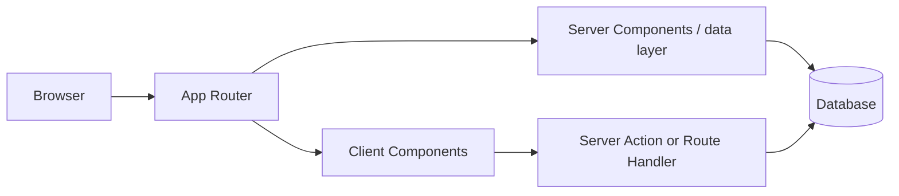

# Next.js Architecture Overview

> **Target:** Next.js 16.x App Router. These notes focus on the named concept; exact behavior can depend on version, configuration, runtime, and host.

## The concept in this file

Describe browser, server runtime, App Router, React Server Components, Client Components, route handlers, data sources, build output, and hosting runtime.

## How it fits into the app

Think of Next.js as the application framework around React: routing, server execution, rendering, assets, and deployment conventions fit together.

A request may use prerendered output, request-time rendering, or client navigation. Route matching and rendering are separate steps, and responses may stream.

For this topic, trace the URL or UI from convention to rendered output. Be explicit about whether the logic runs during build, on a server request, or in the browser.

## Application boundaries

A Route Handler is an HTTP boundary; a Server Component can call the server-only data layer directly.

## Tradeoffs to recognize

The framework reduces integration work but introduces conventions and server/client boundaries a browser-only React SPA may not need.

## Common failure modes for this area

- Separate conceptual architecture from provider-specific deployment details.
- Do not equate framework-managed rendering with automatic performance, SEO, or security.

## Apply it

1. Compare Next.js with React/Vite for a public site and a private tool.
2. Draw which work happens in the browser versus on the server.

**Topic prompt:** Next.js Architecture Overview: explain the runtime behavior and draw the boundary between this feature and the adjacent feature it is commonly confused with.

## Version note

Separate conceptual architecture from provider-specific deployment details.

## Official reference

- [Next.js documentation](https://nextjs.org/docs/app)
- [API reference](https://nextjs.org/docs/app/api-reference)
