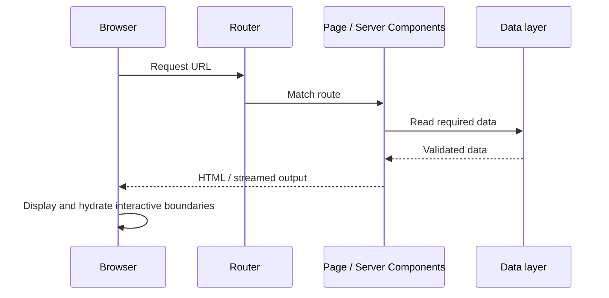

# Rendering and Request Lifecycle

> **Target:** Next.js 16.x App Router. These notes focus on the named concept; exact behavior can depend on version, configuration, runtime, and host.

## The concept in this file

Walk from URL request through routing, rendering/data work, response streaming or HTML delivery, hydration, and client navigation. Include a Mermaid diagram.

## How it fits into the app

Think of Next.js as the application framework around React: routing, server execution, rendering, assets, and deployment conventions fit together.

A request may use prerendered output, request-time rendering, or client navigation. Route matching and rendering are separate steps, and responses may stream.

For this topic, trace the URL or UI from convention to rendered output. Be explicit about whether the logic runs during build, on a server request, or in the browser.

## Request lifecycle

A cached/static response or client navigation can skip or alter parts of this conceptual request path.

## Tradeoffs to recognize

The framework reduces integration work but introduces conventions and server/client boundaries a browser-only React SPA may not need.

## Common failure modes for this area

- Exact steps vary with static output, dynamic rendering, caching, streaming, and hosting.
- Do not equate framework-managed rendering with automatic performance, SEO, or security.

## Apply it

1. Compare Next.js with React/Vite for a public site and a private tool.
2. Draw which work happens in the browser versus on the server.

**Topic prompt:** Rendering and Request Lifecycle: explain the runtime behavior and draw the boundary between this feature and the adjacent feature it is commonly confused with.

## Version note

Exact steps vary with static output, dynamic rendering, caching, streaming, and hosting.

## Official reference

- [Next.js documentation](https://nextjs.org/docs/app)
- [API reference](https://nextjs.org/docs/app/api-reference)
