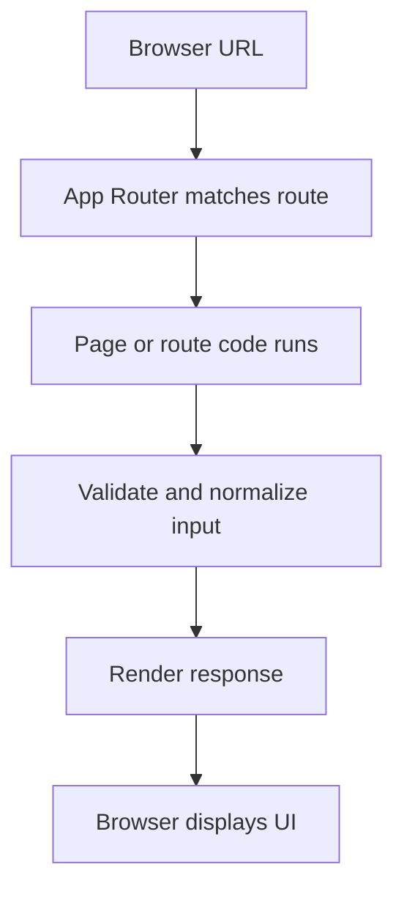

# Mocking Server Dependencies

> **Version target:** Next.js 16.x App Router. Verify version-sensitive behavior against the [official Next.js documentation](https://nextjs.org/docs) and the exact version in your project.

## Learning objectives

By the end of this note, you should be able to:
- Explain the purpose of mocking server dependencies in a Next.js application.
- Describe the relevant request, rendering, or data flow.
- Implement a small example and identify common failure modes.
- Explain the tradeoffs in an interview or code review.

## Core idea

Explain API/database mocks, test doubles, and when a real integration test is more valuable.

In practical terms, decide first **where the code runs**, **what data it trusts**, and **how fresh the result must be**. These three questions often determine the right Next.js API and architecture.

## How to reason about it

1. **Identify the boundary.** Is this route UI, interactive browser UI, an HTTP endpoint, a mutation, or a data-access operation?
2. **Follow the data.** Identify the source, validation, authorization, transformation, and response.
3. **Choose the execution environment.** Keep browser-only APIs in client code and secrets/database access in server-only code.
4. **Define failure behavior.** Consider missing input, unauthorized access, upstream failures, slow work, and stale data.
5. **Test the real behavior.** Check both the happy path and at least one failure path.

## Example

The following is a small illustrative App Router pattern. Adapt the file path and types to the specific feature being implemented.

```tsx
// app/example/page.tsx
type ExamplePageProps = {
  searchParams: Promise<{ q?: string }>;
};

export default async function ExamplePage({ searchParams }: ExamplePageProps) {
  const { q } = await searchParams;
  const query = typeof q === "string" ? q.trim() : "";

  return (
    <main>
      <h1>Mocking Server Dependencies</h1>
      <p>{query ? `Search query: ${query}` : "No search query provided."}</p>
    </main>
  );
}
```

This example demonstrates an App Router page reading query-string state. In current Next.js versions, request APIs such as `searchParams` may be asynchronous; check the installed version's generated types and official API reference before copying signatures into a different version.

## What happens step by step?

1. The router matches the URL to the `app/example/page.tsx` route.
2. The page awaits the query parameters supplied by the framework.
3. The code normalizes the input instead of assuming it is valid.
4. React renders the page output.
5. The browser receives the response and displays the result.



The diagram is a conceptual path; caching, streaming, client navigation, and hosting can change the exact runtime sequence.

## Common mistakes

- Copying code from a different Next.js major version without checking the API signature.
- Treating TypeScript types as runtime validation for user input.
- Placing database access, private keys, or privileged logic in client-reachable modules.
- Assuming a hidden button, redirect, or middleware check is sufficient authorization.
- Ignoring loading, error, empty, and unauthorized states.
- Adding caching without deciding how stale data is allowed to become.

### A better checklist

- [ ] Is the execution environment correct?
- [ ] Are input and returned data validated/limited?
- [ ] Is authorization enforced near the protected operation?
- [ ] Are loading and failure states understandable?
- [ ] Is caching/revalidation intentional?
- [ ] Have I checked the official docs for version-specific details?

## Debugging approach

When this feature behaves unexpectedly:

1. Reproduce with the smallest route or component.
2. Read the exact error message and identify whether it is a build-time, server-runtime, or browser-runtime failure.
3. Check the file convention, imports, and server/client boundary.
4. Inspect the network request and server logs when relevant.
5. Verify environment variables and installed package versions.
6. Add a focused regression test after fixing the root cause.

## Interview answer

A strong answer starts with a short definition, explains why the feature exists, describes how it works in the App Router, and gives one realistic example. Then mention a tradeoff or failure mode rather than claiming the feature is always the best choice.

**Practice answer template:** “I use this when ____. It works by ____. The main benefit is ____, while the tradeoff is ____. In a real application I would also handle ____.”

## Practice exercises

1. Explain the concept without looking at this file in under one minute.
2. Implement the smallest working example in a scratch Next.js app.
3. Identify one incorrect implementation and explain why it fails.
4. Describe one security, performance, or caching consideration.
5. Explain how you would test the behavior.

## Quick revision

- Know the purpose and execution boundary.
- Understand the data flow and failure states.
- Validate untrusted input at runtime.
- Keep authorization near protected data and mutations.
- Confirm version-sensitive details before relying on defaults.

## Official references

- [Next.js documentation](https://nextjs.org/docs)
- [Next.js App Router](https://nextjs.org/docs/app)
- [Next.js API reference](https://nextjs.org/docs/app/api-reference)

## Topic-specific caution

Do not let mocks conceal contract mismatches.
